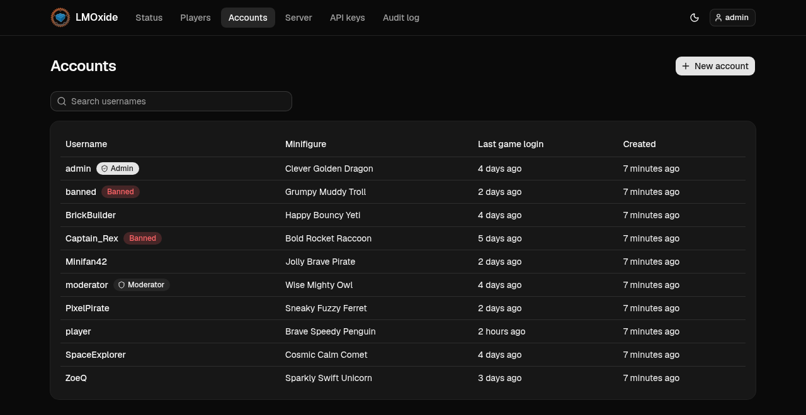
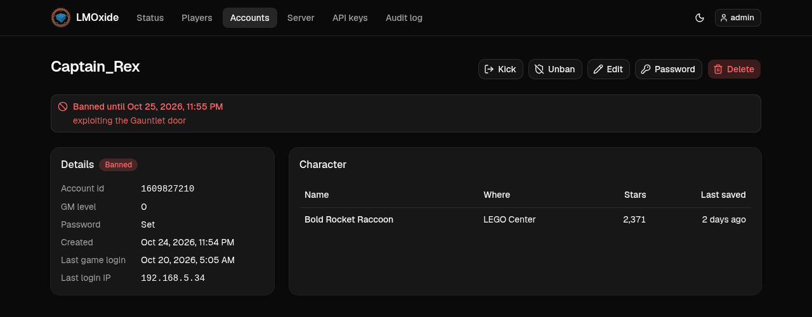
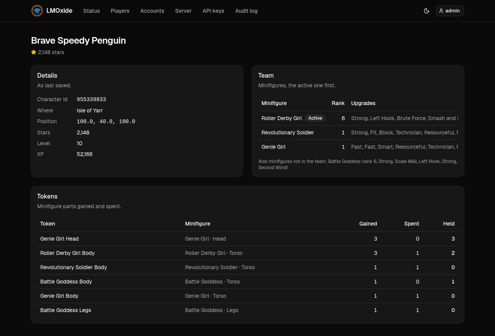
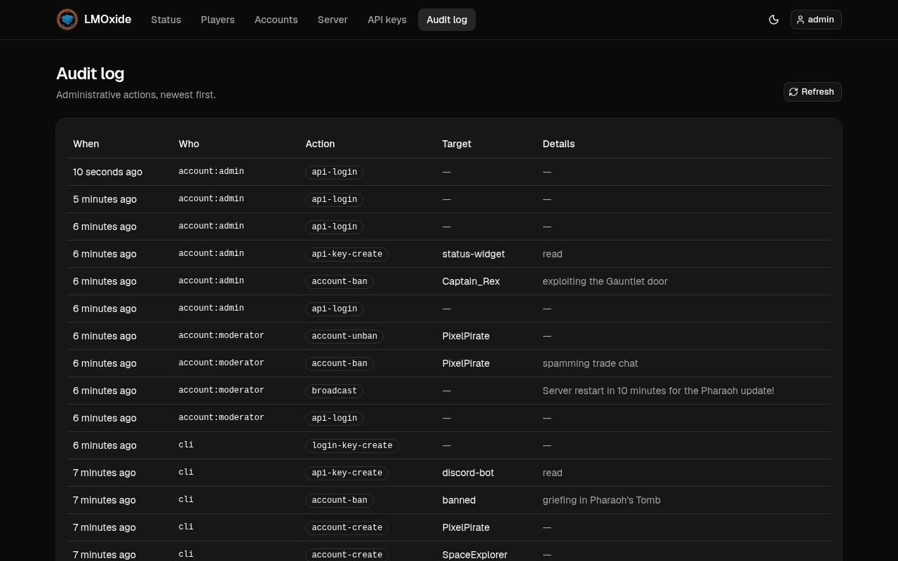

# LMOxide web UI

The website for an [LMOxide](https://github.com/LMOxide/lmoxide) server (LEGO Minifigures
Online). It shows players the server's status, lets them register and manage their account, and
gives moderators and admins a console for running the server.

<p align="center">
  
</p>

| Who | What they get |
|---|---|
| Everyone | server status and who's online; registration (if the server allows it) |
| Players | their account and character; password change |
| Moderators | players online, kick; accounts and characters; bans; broadcasts |
| Admins | creating, editing and deleting accounts, passwords; maintenance mode; API keys for bots; the audit log |

<details>
<summary>More screenshots</summary>

| Account | Character |
|---|---|
|  |  |



</details>

## How it works

A static single-page app that talks only to `lmoxide-api` over HTTP. It has no server of its
own: build it once and serve the files.

- **Stack**: Vite, React 19, TypeScript, Tailwind CSS 4, shadcn/ui (Radix), TanStack Query,
  React Router.
- **API client**: `openapi-fetch`, typed from lmoxide's
  [`docs/openapi.json`](https://github.com/LMOxide/lmoxide/blob/main/docs/openapi.json) by
  `openapi-typescript`. Form limits (username, password, broadcast length) are generated from
  the same schema.
- **Auth**: logging in returns a bearer token, kept in `sessionStorage` (no cookies). The
  account's GM level sets its scope (`read`, `moderate`, `admin`), and the UI shows only what
  that scope allows. The API enforces it either way.
- **Routing**: by default the UI calls the API at `/api` on its own origin, so one reverse proxy
  serves both and CORS never comes into it.

## Setup

Check out the lmoxide repo next to this one (for the API schema and a local backend), then:

```sh
# in ../lmoxide: an API on 127.0.0.1:8090 with demo accounts (needs Rust and protoc)
tools/web-dev-backend.sh

# here (needs Node and pnpm)
pnpm install
pnpm dev                     # http://localhost:5173
```

Log in as `admin`, `moderator`, `player` or `banned`, each with the password `<name>-password`.

To deploy: `pnpm build` and serve `dist/` behind the same reverse proxy as the API. See
[Deploying](docs/DEPLOYING.md).

## Documentation

- [Development](docs/DEVELOPMENT.md): scripts, code layout, the dev proxy, regenerating the API types
- [Deploying](docs/DEPLOYING.md): reverse proxy, separate API origin, sub-paths
- [API proposals](docs/API-PROPOSALS.md): API changes the UI asked for, and what's still open
- In lmoxide: [`WEB-UI.md`](https://github.com/LMOxide/lmoxide/blob/main/docs/WEB-UI.md)
  (auth flow, what each scope may see) and
  [`API.md`](https://github.com/LMOxide/lmoxide/blob/main/docs/API.md)
